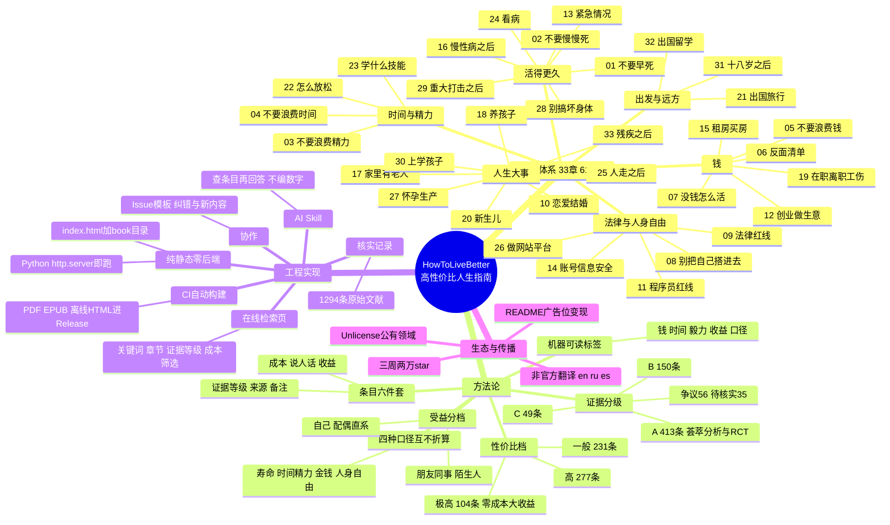

# HowToLiveBetter 调研报告

> 对 [eternity4719/HowToLiveBetter](https://github.com/eternity4719/HowToLiveBetter) 的调研笔记与思维导图。
>
> 原项目一句话：**一份按性价比排序的循证生活指南** —— 612 条建议，每条写明「花掉什么、换回什么、证据有多硬」，来源只引期刊论文和官方文件。

调研时间：2026-09-28 · 数据来源：GitHub API + 仓库 README/正文

## 项目速览

| 项目 | 内容 |
|---|---|
| 仓库 | [eternity4719/HowToLiveBetter](https://github.com/eternity4719/HowToLiveBetter) |
| Star / Fork | 20,697 / 1,488（2026-09-28，仍在涨） |
| 创建时间 | 2026-09-07 —— 上线三周即破 2 万 star |
| 内容体量 | 612 条建议 · 33 章 · 1294 条原始文献链接 |
| 技术栈 | Markdown + 纯静态 HTML，无后端、无数据库、无构建依赖 |
| 许可 | Unlicense（公有领域，可任意使用） |
| 在线版 | https://eternity4719.github.io/HowToLiveBetter/ |

## 内容体系：33 章一览

全书围绕四种「资源」展开：**寿命、时间与精力、金钱、人身自由**。33 章按主题可归为六组：

### 活得更久（健康 · 医疗 · 急救）

| 章 | 主题 | 覆盖内容 |
|---|---|---|
| 01 | 不要早死 | 意外伤害、燃气中毒、疫苗筛查、危机干预 |
| 02 | 不要慢慢死 | 烟酒、运动、睡眠、饮食、久坐、戒烟戒酒的具体办法 |
| 13 | 紧急情况 | 心脏骤停、大出血、火灾、溺水……先做什么 |
| 16 | 慢性病之后 | 服药依从、慢特病报销、并发症筛查 |
| 24 | 看病 | 分级诊疗、报销比例、急诊分诊、伤残鉴定 |
| 28 | 别搞坏身体 | 极端节食、医美风险、减肥药 |
| 29 | 重大打击之后 | 丧亲、失业、重病诊断后的头几个月 |

### 钱（消费 · 理财 · 保障）

| 章 | 主题 | 覆盖内容 |
|---|---|---|
| 05 | 不要浪费钱 | 订阅、彩票、保险、基金费率、预付款 |
| 06 | 反面清单 | 看似划算、实则不值的东西 |
| 07 | 没钱怎么活 | 救助补贴、欠薪维权、住宿吃饭、避坑 |
| 12 | 创业做生意 | 本钱、主体选择、许可证、纳税、退场 |
| 15 | 租房买房 | 押金、中介、资金监管、产权核对 |
| 19 | 在职离职工伤 | 加班费、年休假、N/2N、工伤认定 |

### 法律与人身自由

| 章 | 主题 | 覆盖内容 |
|---|---|---|
| 08 | 别把自己搭进去 | 事故、自首减刑、彩礼、担保、诉讼时效 |
| 09 | 法律红线 | 谣言、兼职洗钱、赌博、高空抛物 |
| 11 | 程序员红线 | 外挂、爬虫、删库、竞业、开源许可 |
| 14 | 账号信息安全 | 二次验证、SIM 卡、手机丢失 |
| 26 | 做网站平台 | ICP 备案、支付红线、内容治理 |

### 时间与精力

| 章 | 主题 | 覆盖内容 |
|---|---|---|
| 03 | 不要浪费精力 | 睡眠、打断、多任务、决策疲劳 |
| 04 | 不要浪费时间 | 沉没成本、拖延、会议、通勤 |
| 22 | 怎么放松 | 娱乐场所避坑、运动正念减压 |
| 23 | 学什么技能 | 教育回报率、考证、怎么学才有效 |

### 人生大事（婚育老幼）

| 章 | 主题 | 覆盖内容 |
|---|---|---|
| 10 | 恋爱结婚 | 择偶、异地恋、婚前财产、退出成本 |
| 17 | 家里有老人 | 监护、遗嘱、养老骗局、长期护理 |
| 18 | 养孩子 | 育儿补贴、产假、时间账钱账 |
| 20 | 新生儿 | 安全睡眠、疫苗、发热就医红线 |
| 25 | 人走之后 | 死亡证明、销户、社保公积金 |
| 27 | 怀孕生产 | 产检、生育保险、出生证明 |
| 30 | 上学孩子 | 欺凌、近视、抑郁筛查 |
| 33 | 残疾之后 | 补贴、无障碍改造、就业、监护 |

### 出发与远方

| 章 | 主题 | 覆盖内容 |
|---|---|---|
| 21 | 出国旅行 | 安全提醒级别、领事保护、境外骗局 |
| 31 | 十八岁之后 | 当兵、升学、打工、社保 —— 十二条路的门槛 |
| 32 | 出国留学 | 签证身份、打工时数、保险、学历认证 |

## 方法论：这本书的"操作系统"

这是全书最值得学的东西 —— 它不是观点合集，而是一套**可复用的决策框架**：

### 每条建议长这样（六件套）

```markdown
### 5. 把家里的食盐换成低钠盐（钾盐）
<!-- 成本标签: 钱=0 时间=少 毅力=否 收益=大 口径=死亡率 -->
- 成本：一袋比普通盐贵几元……
- 说人话：两万人的随机试验里……死亡的概率低约 12%
- 收益：……（随机对照试验的具体数字：RR 0.88）
- 证据等级：A
- 来源：Neal B 等 (2021)……NEJM. https://doi.org/...
- 备注：争议。试验对象是高危老人……
```

关键设计：
- **「说人话」**：把统计术语翻译成日常说法，只看这一行就能拿主意
- **「备注」**：主动写争议和适用边界（如"健康年轻人收益小得多"）
- **成本标签是机器可读的**：藏在 HTML 注释里的 `钱=0 时间=少 毅力=否 收益=大 口径=死亡率`，检索页靠它做筛选 —— **内容即数据**，Markdown 既是书又是数据库

### 证据分级（只回答"可不可信"）

| 等级 | 含义 | 数量 |
|---|---|---|
| A | 荟萃分析 / 大型队列 / 随机对照试验，能说出降了多少 | 413 |
| B | 有研究支持但说不出确切数字，或单项小样本研究 | 150 |
| C | 作者经验或公认做法，无直接文献 | 49 |

另有 56 条标注**争议**（列出反方证据）、35 处标注 **TODO 待核实**。来源只引原始文献（期刊 DOI / WHO、CDC、国家统计局等官方报告），不引二手转述。

### 性价比档（回答"值不值得做"）

证据等级不管值不值，所以另有一套：收益量级（大/中/小）× 三项成本（钱/时间/毅力）→

| 档 | 定义 | 数量 |
|---|---|---|
| 极高 | 好处大，且三项成本全是零 | 104（17%）|
| 高 | 好处大成本不高，或好处中等成本为零 | 277（45%）|
| 一般 | 剩下 | 231（38%）|

最诚实的一句：**"这一档是作者自己的判断，不是证据，按本书的标准它本身只算 C 级。"**

### 四种口径，互不折算

每条只归属一种口径：**换寿命 / 换钱 / 换时间精力 / 换人身自由**。作者明确拒绝通约 —— 「总死亡率降 12%」和「每年省 500 元」不在一把尺子上，没法分高下。

### 受益分档

好处落到谁头上是分开算的：①你自己 ②配偶和直系亲属 ③朋友同事（互惠）④陌生人（最低档，且风险收益一起写）。急救章节就是按这个逻辑写的：79.2% 的院外心脏骤停发生在家里，学按压首先是为了按在自家人身上。

## 工程实现：一个零后端的"内容产品"

| 模块 | 实现 |
|---|---|
| 架构 | 纯静态：`index.html` + `book/*.md`，无后端、无数据库、零依赖；`python -m http.server` 即跑，GitHub Pages 直接托管 |
| 拆分 | 单文件超 GitHub Markdown 512KB 渲染上限 → 拆成 33 个文件，检索页再合起来读 |
| 在线检索 | 按关键词 / 章节 / 证据等级 / 成本三维筛选；条目互链（"见第 X 节第 Y 条"）悬停预览 |
| CI 自动构建 | 正文改动 → GitHub Actions 自动生成 PDF / EPUB / 离线单文件 HTML → 发到 Release，下载链接固定不变 |
| AI Skill | `skills/life-decision-guide/`（另有一份在 `.claude/skills/`），Claude Code / Codex 可装：先查条目再回答，注明出处，查不到就说查不到、不编数字 |
| 核实记录 | `docs/核实记录/` 按章节记录每条来源的核实过程；`docs/引用对照.md` |
| 协作 | `.github/ISSUE_TEMPLATE/`：纠错 / 新内容 两种模板 |
| 给 AI 的说明 | `AGENTS.md` / `CLAUDE.md`：仓库级 AI 协作规范 |
| SEO | `robots.txt` / `sitemap.xml` |

## 生态与传播

- **Unlicense**：公有领域，拿走即用
- **非官方翻译**：en / ru / es（由 dlgrv 维护，滞后于中文原文，以中文为准）
- **三周 2 万 star**：2026-09-07 创建，内容型仓库的罕见增速
- **变现**：README 底部广告位（Minecraft 服务器）—— 个人作者的可持续方式

## 亮点与不足

**亮点**
1. **方法论先行**：成本-收益-证据三维框架，且罕见地诚实（性价比档自认 C 级、作者自称"大部分没做到"）
2. **内容即数据**：成本标签机器可读，一份 Markdown 同时是书和数据库
3. **零成本分发**：纯静态 + CI 三件套 + 离线单文件，传播摩擦极低，微信可直接传
4. **可验证性**：1294 条原始文献、逐条核实记录、争议与 TODO 标注
5. **AI 原生**：Skill 把静态内容变成可问答的助手，且立了"不编数字"的规矩

**不足与风险**
1. 证据解读依赖作者一人，没有同行评审流程
2. 医疗建议的边界：C 级条目掺杂作者经验，读者可能误当医嘱
3. 时效性：法律政策类条目（如签证新规）变化快，需要持续维护
4. 翻译滞后于中文原文；语境高度中文互联网化，跨文化迁移有限

## 思维导图



> 另有一份可交互版本：[mindmap.html](./mindmap.html)（下载后用浏览器打开，可折叠展开）。

## 链接

- 原仓库：https://github.com/eternity4719/HowToLiveBetter
- 在线检索：https://eternity4719.github.io/HowToLiveBetter/
- PDF / EPUB / 离线 HTML：https://github.com/eternity4719/HowToLiveBetter/releases/download/epub-latest/
- 非官方翻译：https://github.com/dlgrv/HowToLiveBetter
